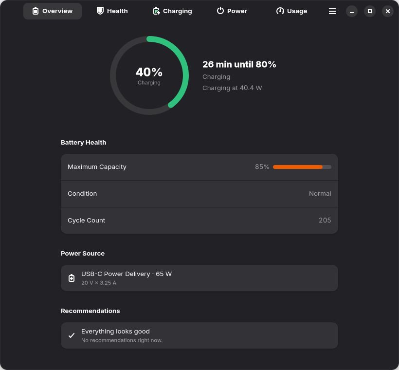
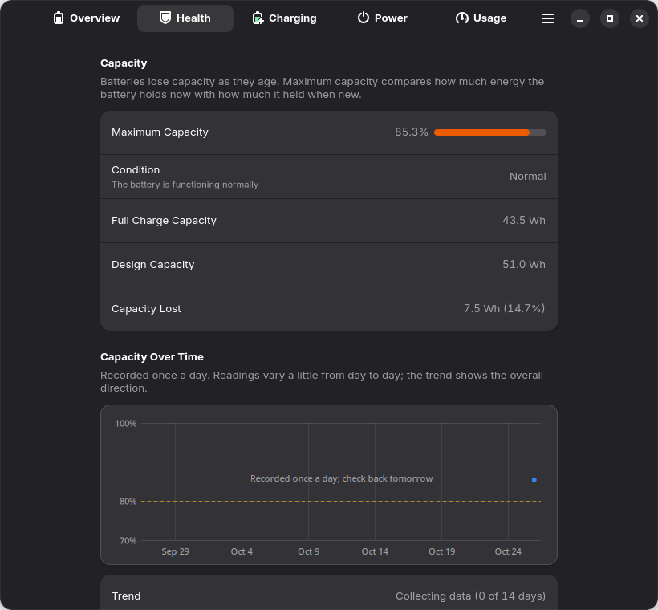
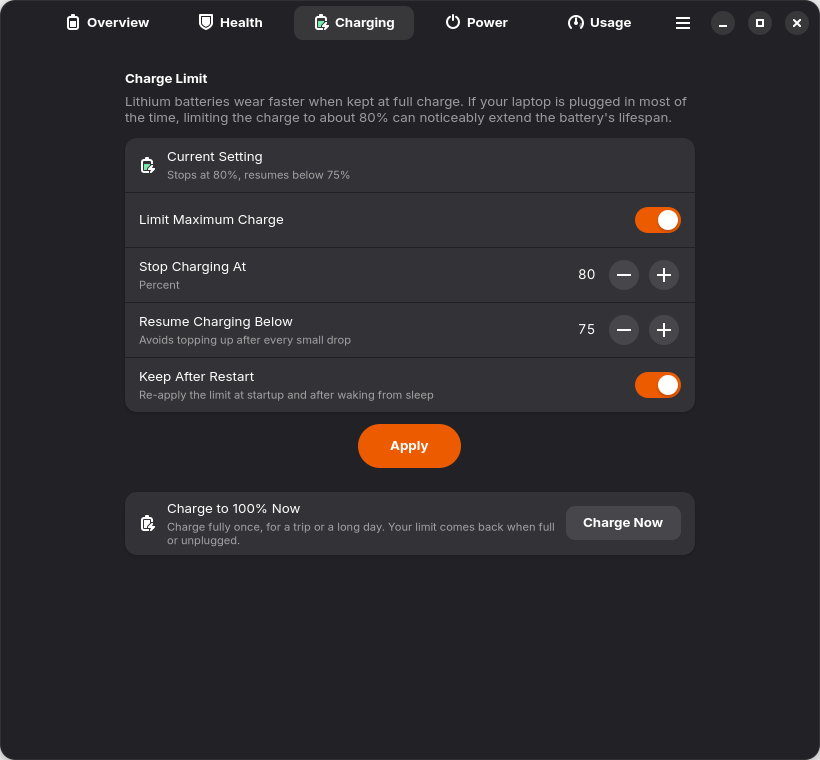
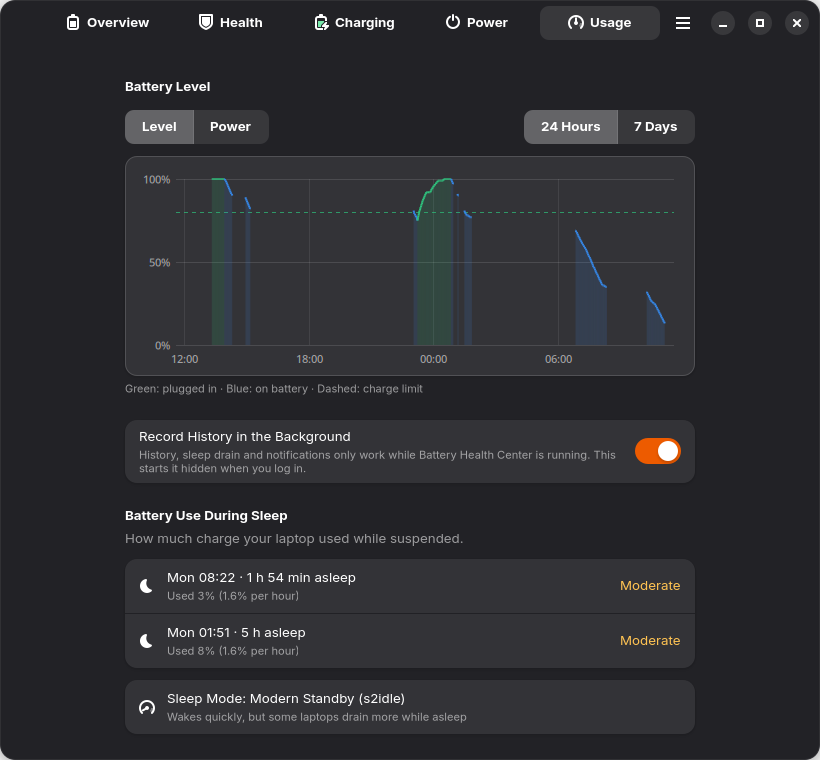

# Battery Health Center: apt repository

A signed apt repository for [Battery Health Center](https://github.com/arios4k/battery-health-center),
a GNOME app that shows everything about your laptop battery in one place: health and cycle count,
charge limits to reduce wear, battery use during sleep, power modes and power-saving settings, and
which apps use the most energy.

**Repository address:** `https://arios4k.github.io/apt`
&nbsp;·&nbsp; **Web page:** [arios4k.github.io/apt](https://arios4k.github.io/apt)
&nbsp;·&nbsp; **Project and issues:** [arios4k/battery-health-center](https://github.com/arios4k/battery-health-center)

This is the **full version** of the app. If you'd rather use the sandboxed one, there is also a
[snap](https://snapcraft.io/battery-health-center) (see [apt or snap?](#apt-or-snap)).

## Screenshots

<p align="center">
  
  
</p>
<p align="center">
  
  
</p>
<p align="center">
  
</p>

The Power page, with power modes and GNOME's power-saving settings, is only in the apt version.

---

## Contents

- [Screenshots](#screenshots)
- [Install](#install)
- [Which systems it works on](#which-systems-it-works-on)
- [Check the signing key](#check-the-signing-key)
- [Update and remove](#update-and-remove)
- [Other ways to add the repository](#other-ways-to-add-the-repository)
- [What gets installed](#what-gets-installed)
- [apt or snap?](#apt-or-snap)
- [Troubleshooting](#troubleshooting)
- [How the repository is built](#how-the-repository-is-built) (for maintainers)

---

## Install

Add the repository once, then install the app. After that, `apt` keeps it up to date together with
the rest of your system.

```bash
sudo install -d -m 0755 /etc/apt/keyrings
```

```bash
curl -fsSL https://arios4k.github.io/apt/key.asc | sudo tee /etc/apt/keyrings/battery-health-center.asc > /dev/null
```

```bash
echo "deb [signed-by=/etc/apt/keyrings/battery-health-center.asc] https://arios4k.github.io/apt stable main" | sudo tee /etc/apt/sources.list.d/battery-health-center.list
```

```bash
sudo apt update && sudo apt install battery-health-center
```

Then open **Battery Health Center** from your applications.

What each command does:

| Step | Purpose |
| --- | --- |
| `install -d …/keyrings` | Makes sure the folder for apt's signing keys exists (it already does on current systems). |
| `curl … key.asc \| tee …` | Downloads the repository's public signing key. `apt` uses it to check that packages come from this project and weren't altered. |
| `echo "deb [signed-by=…] …"` | Adds the repository. `signed-by` limits the key to *this* repository only, so it can't vouch for any other software. |
| `apt update && apt install` | Reads the repository's index and installs the app with everything it needs. |

## Which systems it works on

The package is built for **64-bit Intel/AMD (amd64)** and needs **glibc 2.39, GTK 4.14 and libadwaita 1.5
or newer**.

| System | Status |
| --- | --- |
| Ubuntu 24.04 LTS | Tested (clean install in a container) |
| Zorin OS 18 | Tested (the author's laptop) |
| Linux Mint 22 | Expected to work (it is built on Ubuntu 24.04), not tested |
| Debian 13 ("trixie") and newer | Expected to work (newer libraries), not tested |
| Ubuntu 22.04, Linux Mint 21, Debian 12 | **Not supported**: their libraries are too old |
| arm64 and other architectures | **Not supported**: only amd64 is published |

On an unsupported system `apt install` stops with a message like
`Depends: libc6 (>= 2.39) but 2.35-0ubuntu3 is to be installed`. Nothing is changed.

The app itself is for laptops with a battery. Charge limits additionally need firmware that exposes charge
thresholds to the kernel (ThinkPads and many other laptops do); everything else works on any laptop.

## Check the signing key

Every package and the repository index are signed with one key:

| | |
| --- | --- |
| **Name** | Battery Health Center Packages `<182820807+arios4k@users.noreply.github.com>` |
| **Fingerprint** | `F090 D01D 74F7 14C8 5A95 23CA 4773 367E BD97 6CF5` |
| **Type** | RSA 4096, signing only, never expires |
| **Created** | 2026-10-26 |
| **Download** | [`key.asc`](key.asc) |

To check that the key you downloaded is the right one, print its fingerprint and compare the long line
with the one above:

```bash
gpg --show-keys --with-fingerprint /etc/apt/keyrings/battery-health-center.asc
```

The same fingerprint is published in three places that you can compare: this page, the
[web page](https://arios4k.github.io/apt), and the
[project README](https://github.com/arios4k/battery-health-center#from-the-apt-repository).

## Update and remove

```bash
sudo apt update && sudo apt upgrade
```

Updates arrive together with your normal system updates.

**Remove the app** (keeps its saved settings and charge limit file):

```bash
sudo apt remove battery-health-center
```

**Remove it completely**, including the service's state, and stop using the repository:

```bash
sudo apt purge battery-health-center
```

```bash
sudo rm /etc/apt/sources.list.d/battery-health-center.list /etc/apt/keyrings/battery-health-center.asc
```

**Good to know:** uninstalling does **not** undo a charge limit. The battery keeps the limit you set until
you change it (some laptops even keep it across restarts). To go back to charging to 100%:

```bash
echo 100 | sudo tee /sys/class/power_supply/BAT0/charge_control_end_threshold
```

(use `charge_stop_threshold` instead if that is the file your laptop has, and replace `BAT0` if your battery
is named differently).

## Other ways to add the repository

### The newer `.sources` format

Instead of the `.list` file above, current systems also accept this format. First download the key as in
the install steps, then:

```bash
sudo tee /etc/apt/sources.list.d/battery-health-center.sources > /dev/null <<'EOF'
Types: deb
URIs: https://arios4k.github.io/apt
Suites: stable
Components: main
Architectures: amd64
Signed-By: /etc/apt/keyrings/battery-health-center.asc
EOF
```

Use one format or the other, not both.

### Download the package without adding the repository

The package file is in the repository's `pool` folder:

```
https://arios4k.github.io/apt/pool/main/b/battery-health-center/battery-health-center_<version>-1_amd64.deb
```

Download it, check its SHA-256 against the `SHA256:` line for the package in
[`Packages`](dists/stable/main/binary-amd64/Packages), and install it with
`sudo apt install ./battery-health-center_<version>-1_amd64.deb`. Installing this way means no automatic
updates. Only the **newest** version is kept in the repository; older ones are removed.

## What gets installed

| Path | What it is |
| --- | --- |
| `/usr/bin/battery-health-center` | The app |
| `/usr/libexec/battery-health-center/bhc-helper` | A small helper that changes the charge limit. It runs as root only when you apply a limit, after a PolicyKit password prompt, and accepts only checked values |
| `/usr/share/polkit-1/actions/io.github.BatteryHealthCenter.policy` | The PolicyKit rule for that prompt |
| `/usr/lib/systemd/system/battery-health-center-restore.service` | Re-applies your saved charge limit at boot and after sleep (enabled automatically) |
| Launcher, icon, AppStream metadata, man page | The usual desktop files |

Files the app creates for you:

| Path | Contents |
| --- | --- |
| `~/.local/share/battery-health-center/` | Battery history, daily capacity log, per-app energy history |
| `~/.config/battery-health-center/settings.ini` | Your preferences |
| `~/.config/autostart/io.github.BatteryHealthCenter.desktop` | Only if you turn on "Record History in the Background" |
| `/etc/battery-health-center.conf` | Your saved charge limit |

Removing the app leaves these in place. Delete them yourself if you want a clean slate.

## apt or snap?

| | apt (this repository) | [Snap Store](https://snapcraft.io/battery-health-center) |
| --- | --- | --- |
| Real icons for every app on the Usage page | Yes | Only for other snaps |
| Per-app energy use | All apps | All apps |
| Power mode, automatic power mode, GNOME power-saving settings | Yes | No (the sandbox blocks them) |
| Charge limit | Yes (PolicyKit password prompt) | Yes (needs the manual permissions below) |
| After installing | Works at once | Needs `sudo snap connect` for `hardware-observe`, `system-observe` and `power-control` |
| Updates | With your system updates | Automatically by snapd |
| Works on | Ubuntu 24.04 and newer, Zorin 18, and similar | Any distribution with snapd |

Don't install both on the same laptop: they would both manage your charge limit.

## Troubleshooting

| What you see | Why | What to do |
| --- | --- | --- |
| `NO_PUBKEY 4773367EBD976CF5` and `The repository 'https://arios4k.github.io/apt stable InRelease' is not signed.` | The signing key is missing or the `signed-by` path is wrong | Repeat the `curl … key.asc` step and check that the path in the `.list` file matches |
| `Unable to locate package battery-health-center` | The repository isn't added, or `apt update` wasn't run | Check that `/etc/apt/sources.list.d/battery-health-center.list` exists, then `sudo apt update` |
| `The following packages have unmet dependencies … libc6 (>= 2.39)` | The system is too old (see [Which systems it works on](#which-systems-it-works-on)) | Use the snap instead, or upgrade the system |
| `404 Not Found` or `Failed to fetch` for `arios4k.github.io` | A typo in the address, no internet, or the site is rebuilding after a release | Check the address, wait a few minutes and run `sudo apt update` again |
| The app's icon is blank in the app list | A stale icon cache from an older install made with the project's `install.sh` | `sudo gtk-update-icon-cache -f -t /usr/local/share/icons/hicolor`, then log out and in |
| Both the snap and this package are installed | They would both manage the charge limit | Remove one: `sudo snap remove battery-health-center` or `sudo apt remove battery-health-center` |
| The charge limit asks for a password every time | PolicyKit remembers it only for a few minutes | This is expected; it is what keeps the helper safe |
| Something else | | [Open an issue](https://github.com/arios4k/battery-health-center/issues) with your distribution and `apt-cache policy battery-health-center` |

## How the repository is built

*This part is for maintainers.*

### Layout

```
dists/stable/
    InRelease                          the index, signed (clear-signed)
    Release, Release.gpg               the same index with a detached signature
    main/binary-amd64/Packages(.gz)    package list with versions and SHA-256 checksums
pool/main/b/battery-health-center/     the .deb file
key.asc                                the public signing key
index.html                             the web page
```

`apt` downloads `InRelease`, checks its signature against the key, then trusts the checksums inside it
for `Packages`, and the checksums in `Packages` for the `.deb`. A changed or swapped file fails the check.

The repository uses suite `stable`, component `main` and architecture `amd64`. It is a plain static site
served by GitHub Pages from the `main` branch; `.nojekyll` stops GitHub from processing it.

### Publishing a new version

Everything is done from the [application repository](https://github.com/arios4k/battery-health-center):
bump the version in `Cargo.toml`, add an entry to `data/deb/changelog`, then run

```bash
scripts/publish-apt.sh
```

It builds the package with `cargo deb`, adds it with `reprepro`, signs the index and commits and pushes
this repository. `DRY_RUN=1 scripts/publish-apt.sh` shows the steps without doing anything. `reprepro`
keeps only the newest version of the package, so the previous file is deleted from `pool/` and the next
release replaces it.

### What lives where

| Place | Contents | Published? |
| --- | --- | --- |
| This repository (`~/apt-site`) | `dists/`, `pool/`, `key.asc`, `index.html`, this README | Yes |
| `~/apt-repo/conf/` | `reprepro`'s configuration (`distributions`, `options`) | **No** |
| `~/apt-repo/db/` | `reprepro`'s database | **No** |
| `~/.gnupg/` | The private signing key | **Never** |
| `~/signing-key-backup/` | An encrypted copy of the key, its public half and a revocation certificate | **Never** (keep offline) |

`conf/distributions` contains:

```
Origin: Battery Health Center
Label: Battery Health Center
Codename: stable
Suite: stable
Architectures: amd64
Components: main
Description: Battery Health Center packages
SignWith: F090D01D74F714C85A9523CA4773367EBD976CF5
```

and `conf/options` sets `outdir` to the folder of this repository.

### If the key is ever lost or exposed

The private key is protected by a passphrase and backed up offline. If it is lost, or if it is stolen and
you can't be sure the passphrase held:

1. Import the revocation certificate from the backup (`gpg --import revocation-certificate.asc`) and
   publish the revoked public key as `key.asc`.
2. Create a new key, put its fingerprint in `conf/distributions`, republish, and tell users to replace
   `/etc/apt/keyrings/battery-health-center.asc`.

Until users replace the key, `apt update` will report the repository as untrustworthy, which is the point.

---

The packages are licensed under the GNU General Public License, version 3 or later; see the
[project](https://github.com/arios4k/battery-health-center) for the source code.
